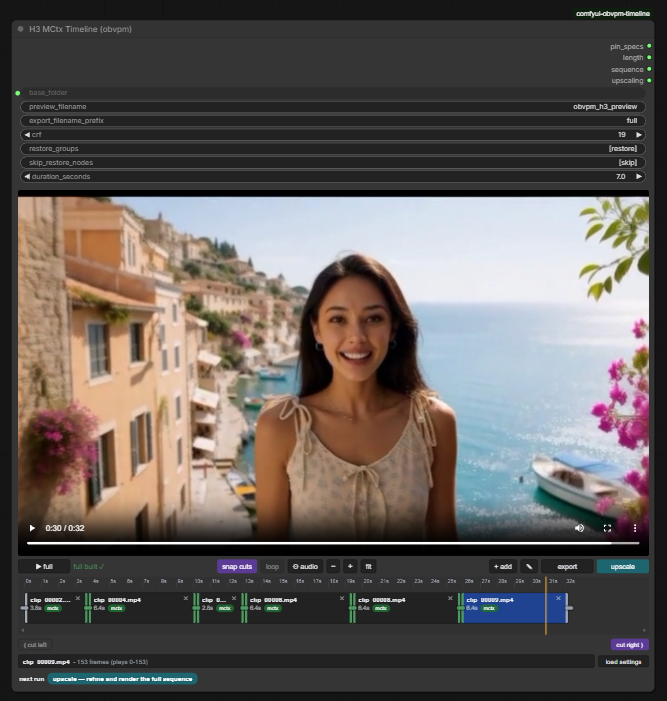

# comfyui-obvpm-timeline

A MiniMax H3 ComfyUI workflow and nodes that allow generating, extending, prepending, bridging and editing videos in an easy to use UI.

The timeline node is like a mini video editor.

And it also supports creating seamless looping videos.



## Support this work

If these nodes and workflows save you time, consider supporting their development on Patreon. **Supporters get early access to new features and workflows.**

<a href="https://www.patreon.com/cw/obvpm"></a>

## Updates

### Workflow Updates

#### v0.1.4-007 (Latest HEAD)

- New workflow [`h3_obvpm_timeline_r2v_v0.1.4-007.json`](workflows/h3_obvpm_timeline_r2v_v0.1.4-007.json). It runs on this pack's 0.1.4.
- **Needs [comfyui-obvpm](https://github.com/chanon/comfyui-obvpm) 0.2.14 or newer and comfyui-obvpm-timeline 0.1.4 or newer.** The Compatibility Check node says so when the workflow loads.
- The generation and upscale engines are switched on and off as whole groups: a **Mute Group If** switch in each engine group (Run when Generating, Run when Upscaling) mutes the engine that is not used for the run, decided from the timeline's `upscaling` before the run starts. Before, a gate inside each engine stopped it during the run.
- **H3 Model** (an Override Bundle Values node): turn on its `model` override to run a different model than the one in the engine settings preset, without editing the preset.
- Generation and upscale load their VAEs separately: generation defaults to the faster `minimax_h3_video_vae_int8_convrot.safetensors`, while the upscale keeps `minimax_h3_video_vae_fp16.safetensors` for the final quality.
- A **Megapixels Resolution Reference** note beside the timeline lists the width x height each megapixels setting gives at 16:9 and 4:3.
- The live preview while sampling comes from the new **H3 Live Preview** node (with `taeh3.safetensors` in `models/vae_approx`) instead of KJNodes' Model Preview Override: the whole clip, pinned frames included, plays under the Result Preview's bar while it samples.

#### v0.1.1-006 (2026-09-28)

- New workflow [`h3_obvpm_timeline_r2v_v0.1.1-006.json`](workflows/h3_obvpm_timeline_r2v_v0.1.1-006.json). It runs on this pack's 0.1.1, with the same requirements as 005.
- **New latent upscaler model:** the upscale pass now uses `minimax_h3_latent_upscaler_3d_conv_v1_fp16.safetensors` (the previous file is no longer published). Download it from [Hugging Face](https://huggingface.co/LBH-123-AI/Minimax_h3_latent_Upscaler/blob/main/minimax_h3_latent_upscaler_3d_conv_v1/minimax_h3_latent_upscaler_3d_conv_v1_fp16.safetensors) into `ComfyUI/models/latent_upscale_models/`.
- Fixed: an engine preset's `shift_video` did not change the noise schedule (the scheduler always used the model's built-in shift of 12, and the preset value only affected the audio). The shift is now applied once, in H3 Model Optimization, so it shapes the schedule and the sparse attention window too. The included presets all use 12, so their results are unchanged.

Full history in [workflows/README.md](workflows/README.md)

### comfyui-obvpm-timeline Custom Node Pack Updates

#### 0.1.4 (2026-10-08)

- New: **H3 Live Preview**, the sampler's picture in the Result Preview while it samples: each step as a clip on the take's own timeline, the pinned frames at the ends included, so a join can be judged while it is made. It replaces KJNodes' Model Preview Override (still shown when that is what is in the graph).
- New: the Result Preview plays with its own bar **below** the picture (play / pause, frame step, seek, volume, loop, fullscreen) instead of the browser's controls over the frame. The live picture plays under it too and no longer starts over at every step, so the whole clip can be watched, paused and seeked while the Run samples.
- Fixed: takes in a folder that is a symlink or Windows junction inside the output folder (a project folder on another drive) failed to load, extend or upscale ("escapes the output folder"); links inside the output folder are now followed, and listed.
- Fixed: adding a prepend to the timeline moved the clip it leads into (and everything after it) earlier by the frames the take cuts off its start, usually 0.54 s; now they stay where they were. The same for an extend that leaves its clip just before its end.
- Fixed: sound at extend joins -- an 8.3 ms skip at joins from clips whose length is not a multiple of 3 (the take's MP4 now has its sound cut on its own frames), a 25 ms skip or repeat in the upscale on chains of off-grid cuts, near-silence just before crossfaded joins, and a false "unexpected audio grid" warning. Previews rebuild once.
- Changed: a Run whose latent upscaler has `enable_temporal_chunking` off is refused, since upscaling without it was seen inventing details the clip never had.
- Changed: the Result Preview's live picture has no right-click switch any more (an old workflow could turn it off unnoticed); it always shows, and only the frames of its own branch's sampler.
- Fixed: videos are never painted with the browser's blue text selection by a double click or drag; status lines stay selectable.
- H3 MCtx Result Preview's `path` is optional, so its Save node can be muted for a Run (Mute Group If, comfyui-obvpm 0.2.11 or newer).
- New: a very short take can be continued (its window reaches back into the frames it held), and a prepend close to a clip's end takes its window from the take that continues the clip, or says how many frames are left.
- Extends, prepends and bridges: a new take takes over one latent step earlier at its join (4 frames before the end of the clip it extends). The decoder draws a file's last frames with nothing after them, so the older clip's last frames never quite matched the new take, which decoded the same latents mid-file. The join's fine-detail change drops by about a third (measured at 1376x768), in the quick preview too, with nothing re-encoded. Takes made before keep their join; the upscale is unchanged.
- Timeline: clips joined by a green seam can now be separated. Ctrl+drag the right-hand clip to open empty space between them; both keep playing the frames they played while joined. Dragging it back flush rejoins them.
- Timeline: new **split** button in the middle of the cut row. It splits the clip under the playhead into two clips at that frame (on the snap grid while **snap cuts** is on), which can then be moved, cut or deleted separately. Both halves play the same file; nothing is re-encoded. The button is dimmed while the playhead sits on the clip's edge. The two halves join back-to-back, so an upscale treats the split as a cut.
- Timeline: extend, prepend, bridge and loop now act on the one clip you picked when the same file is in the timeline more than once (the parts of a split clip). Before, all parts showed the pin and it was unclear which one the next run would continue from. The pin row names the part (for example `clip_00033.mp4 (part 2/3)`), the pin carries that part's cut, and the new take is placed next to the part it continues from.
- Timeline: removing a clip with its ✕ now always leaves its time as empty space of the same length (merged with any beside it), so nothing after it moves, and the clips either side keep the frames they played -- before, the rest of the cut slid left to close the hole, and a clip that the removed one had continued could grow back the frames it had been cut at. A clip with nothing after it is simply removed, and so is the first clip of a looping cut. The gap's own ✕ still closes a gap.
- Result Preview: keeps nothing in the workflow any more. A finished run, adding or dismissing a take and its seam settings no longer create undo steps or change the workflow file, an undo elsewhere never brings an older result back, and a shared workflow no longer carries your last result. When a workflow opens, each preview shows this session's result, or else the newest take its Save node wrote (judged as a run would, cached per file). Dismissed takes and seam settings are remembered in this browser; settings saved in older workflows are carried over once.
- Result Preview: **dismiss** now clears the result from the preview instead of only hiding the buttons (the take stays on disk), and is offered for any result on screen, including a take already added to the timeline. A preview you cleared -- by dismissing or deleting its take -- stays empty when the workflow is opened again until a newer take exists. Before, a refresh brought up the take before the one you deleted, which read as a result you did not remember running.
- Result Preview: the upscale preview plays the rendered file itself (`upscale_00001.mp4`) instead of building a preview copy of it, so it starts at once and shows exactly the rendered pixels -- the copy was re-encoded, a second generation of the picture being judged. Only the take preview still builds `obvpm_h3_result.mp4`. The two used to share that file, rebuilt each other's preview on every look, and two builds at once failed with "The system cannot find the file specified" (`...obvpm_h3_result.mp4.tmp.mp4`). Builds of one preview file now also run one at a time, each with its own temp file, and an export copies the preview while holding that turn.
- Timeline: the parts of a split clip carry a part id in their sequence line (`[id=k3x9]`; a file that is in the cut only once never gets one), and a pin names its part by that id rather than by position. The pin now stays on its part when other parts are moved, split or deleted; a pin on a clip you split moves to the half that keeps the edge it continues from; and a pin whose own part is deleted is cleared, with the pin row saying so, instead of silently jumping to another part. The new take records its part and the cut it was queued from, so it goes back next to that part even after a reload (or next to the other half, when that part was split meanwhile and the half now owns the edge it continues from), and if that part's cut was changed while the take was generating you are asked whether to put it back (seamless) or keep yours (a cut) -- before, the cut was reset without asking and the message blamed the 17-frame grid.
- Timeline: the seam menu's list of existing takes checks where each take joins, not only which file it continues. Takes of the same file that join at another part's edge, or at a point this part's cut no longer reaches, are listed apart under *joins elsewhere*, dimmed, with their join frame. A green link whose hand cut does not meet the natural join frame now shows as a cut on the strip, matching how the upscale treats it.
- Timeline, fixed: adding a take that leads into a clip whose start is cut -- a prepend, or the right side of a bridge, which is always the case for the right half of a split clip -- left that clip starting where it was cut, so the frames between that cut and where the take hands over played twice: the join looked seamless in the Result Preview and rewound a little in the timeline. The clip now starts where the take hands over, as the clip before a take already ended where the take continues from; if you changed its start while the take was generating, you are asked.
- Timeline: clip and empty-space lengths are shown to two decimals (`2.33s`), like the total below the strip, and so are the space readouts while you drag.
- Timeline: **Space** plays and pauses the preview -- the full build when there is a current one, quick otherwise (Space never starts a build). It goes to the timeline under the mouse, else the selected one, else the only one in the workflow, and acts as the key goes down. Holding Space to pan the canvas still pans (the press toggles playback too), and Space still types in text fields.
- Timeline: after an edit (a cut, a move, a delete, the text editor) the picture shows the new cut at the playhead straight away. Before, it kept showing the old cut until the ruler was touched.
- Timeline: a **sideways wheel** over the ruler or the strip (a mouse's thumb or tilt wheel, such as on a Logitech MX Master, or Shift + wheel) moves the playhead back and forth, by half as far as you scroll, with the picture following; zoomed in, the strip scrolls along with it. A plain up/down wheel is unchanged.
- Timeline, fixed: with Nodes 2.0, the wheel over the ruler and Ctrl + wheel over the strip did not zoom (the node passed the wheel to the canvas first).
- Timeline, fixed: quick play stopped at the first empty space instead of playing through it (a gap has no clip for the info row to describe, and that error ended the playback). The info row now says "empty space" there, and pausing inside empty space holds the playhead where it is.
- Result Preview: a take's neighbours play as the timeline plays them, from where the take joins them to the other edge of their part in the timeline. A take between two parts of a long split clip used to preview with the rest of the file around it (29 s for a take that is 7.3 s in the cut). With no timeline holding the part, the whole clip plays as before.
- Load settings: a Value Presets node ([comfyui-obvpm](https://github.com/chanon/comfyui-obvpm), 0.2.14 or newer) is listed setting by setting instead of as raw widget text. Each changed value is its own row. A changed schema, and each workflow preset that differs, is one row, unticked by default, with what changed inside it (per field: type, default, `when`, tooltip; per preset: its values) behind a collapsed toggle. Loading the preset label no longer puts that preset's stored values over the take's own.
- Fixed ([#15](https://github.com/chanon/comfyui-obvpm-timeline/issues/15)): clips could show **no mctx** (and extends fell back to the pixel route, with no loop option) although their `.mctx.safetensors` was right beside them, when the browser could not read the sidecar itself. The server now answers for it, and a clip without a usable sidecar says why in its tooltip: no sidecar, a sidecar that no longer matches the video, or one that could not be read.
- Takes extended or prepended from a clip in another folder now record where that clip was, so Result Preview can show them together instead of the take alone.
- A `base_folder` typed with backslashes (`projects\my_project`) now works like `projects/my_project`. The Timeline's clip menu used to find nothing in it.
- The Timeline's upscale toggle can now be read before a run. With [comfyui-obvpm](https://github.com/chanon/comfyui-obvpm) 0.2.14 or newer, the workflow shows which engine settings the next run will use: Override Bundle Values shows their values, and the Value Presets the run will not use are faded.
- Upscaling: a timeline with hard cuts (unrelated clips, gray seams) or empty space can now be upscaled. It is split into segments that are upscaled, refined and rendered separately (`upscale_00001_s01.mp4`, `_s02`, ...) and joined into one finished `upscale_00001.mp4`, black for empty space, the sound de-clicked at the cuts. Before, such a timeline failed with "not on the latent grid", or its second shot started mid-cycle.
- Upscaling: only what the cut shows is upscaled and refined. A take trimmed to a few seconds is no longer processed whole, and the rendered file now ends where the last clip's cut says (it used to run to the end of the last take).
- Upscaling: a cut made by hand on a seamless (green) seam is now honoured as a cut. Before, the upscale silently played the natural join instead.
- The "not on the latent grid" error now names the clip and the nearest frames that would work.
- Fixed: colours of saved takes and upscales looked shifted in browsers (including the timeline preview), video players and editors -- greens duller, skin and warm tones redder. Videos are now encoded with the BT.709 colour matrix and tagged as such, like ComfyUI's own Save Video. Takes saved before this update keep playing as before, and a timeline mixing old and new takes still previews and exports correctly, only slower: such a preview or export is re-encoded as a whole instead of copied.

#### 0.1.1 (2026-09-23)

- **Update [comfyui-obvpm](https://github.com/chanon/comfyui-obvpm) to the latest version (0.2.5 or newer) as well.** It fixes compatibility bugs the timeline workflow runs into: presets not switching on ComfyUI frontend 1.53 (ComfyUI 0.37), Bundle pin names on a non-English frontend, and the "Converting circular structure to JSON" error when loading the workflow from a saved video with Nodes 2.0 on ComfyUI 0.36.
- Fixed: upscaling a timeline short enough to fit in one sampling window (about 7.8 s at the default window of 39) failed at the refine sampler with `TypeError: list indices must be integers or slices, not NoneType`. Longer timelines were not affected.
- The Timeline node refuses to run on a ComfyUI or comfyui-obvpm too old for the workflow (ComfyUI 0.35.0, comfyui-obvpm 0.2.5), saying what to update and where, instead of failing downstream.
- The package published to the Comfy Registry no longer contains the tests and CI helpers, only the pack itself (`.comfyignore`).

#### 0.1.0 (2026-09-21)

- First release.

Full change history in [CHANGELOG.md](CHANGELOG.md)

## Watch the Tutorial

The best way to learn how to use the Timeline and workflow is by watching the YouTube tutorial video:

[](https://youtu.be/kqP09NfJXaQ)

**Watch on YouTube: [https://youtu.be/kqP09NfJXaQ](https://youtu.be/kqP09NfJXaQ)**

## Features

The main node is the **Timeline** node: the clips you generate are placed on it, and it is where you arrange, cut and preview them, and pick which clip the next generation continues from.

Generate a clip, see if you like it, add it to the timeline, then extend from it. Any part you don't like can be redone later.

Every generated clip is saved together with a motion context file (`.mctx`) that holds its latents. Extensions continue from those original latents using latent masks, not from re-encoded pixels, so there are no lighting changes or flickers at the joins. And because the files sit next to the clips, a clip can still be extended at full quality days or months later.

**Generating**

- **Extend** a clip seamlessly.
- **Prepend**: generate what happens *before* a clip
- **Bridge**: generate what happens between the end of one clip and the beginning of another. This lets you redo any section of the video, and bridging onto a fresh generation brings the quality back if it has drifted.
- **Loop**: bridge the last clip back to the first clip to make a seamless looping video.
- **Extend from a cut**: if a clip ends badly, cut off the bad part and extend from the good part. Snap cuts keeps cuts on the latent frame grid.
- Clips that have no motion context (external clips, clips from other workflows) can be extended too, with seam improvements applied automatically.
- **Result preview**: plays each new clip joined to its neighbours and rates how seamless the join is. From there you add it to the timeline, delete it or dismiss it.
- **Live preview**: the H3 Live Preview node shows the sampler's picture in the result preview while it samples, the whole clip on the take's timeline under the preview's own player bar. Lets you quickly see if a generation is going wrong.

**Timeline**

- **Mini Video Editor**: Drag in clips from anywhere, reorder them by dragging, trim the ends, cut left / cut right at the playhead, undo cuts, and open gaps.
- **Quick preview**: plays through the clips right away. **Full preview** assembles them into a single video file, losslessly where possible. **Export** saves the finished video.
- **Load Settings, Prompts from Clips**: restores the prompt, seed, settings and references that a clip was generated with, so you don't have to keep track of them yourself.
- **Swap takes**: Swap between previous takes generated for the same extension, so you can go back to them and swap between them on the timeline.
- The sequence is also available as text, for copying a timeline into another workflow.

**Upscaling**

- A latent upscale and refine of the **whole sequence in one pass**, so details stay consistent across the joins and the result is still seamless.
- Sampling is done in windows, so long or high resolution videos still fit in VRAM.
- Generate at low resolution for fast iteration, then upscale once at the end. This is optional, you can also generate the first pass at final quality.
- Each clip's conditioning is saved with it, so the upscale uses the same references the clip was generated with.

**Workflow**

- Organized for fast and easy use. All inputs are in one area. No pan all over the workflow to change things.
- **Settings Presets**: Allows you to save frequently used settings such as steps, turbo, and sampling settings and control them in one place
- Up to four image references, plus video and audio references. (More can be added)

## Dependencies

**ComfyUI 0.35.0 (2026-09-09) or newer is needed:** the workflow's Model Optimization uses core's `Model Sparse Attention` node, which arrived there.

The workflows use these custom node packs, so install all of them:

| Custom node pack                                                                                       | Used for                                                                                  |
| ------------------------------------------------------------------------------------------------------ | ----------------------------------------------------------------------------------------- |
| [comfyui-obvpm-timeline](https://github.com/chanon/comfyui-obvpm-timeline) (this pack)                 | The Timeline node, pins, joint render, upscale pass, result preview                       |
| [comfyui-obvpm](https://github.com/chanon/comfyui-obvpm) (0.2.9 or newer)                              | Bundles, Settings Presets, switches and gates, Load Images & Compose, Compatibility Check |
| [ComfyUI-KJNodes](https://github.com/kijai/ComfyUI-KJNodes)                                            | Set / Get nodes, Sage attention patch                                                     |
| [Comfyui_Minimax_h3_latent_Upscaler](https://github.com/LBH-123-AI/Comfyui_Minimax_h3_latent_Upscaler) | The latent upscaler used by the upscale pass                                              |
| [ComfyUI-MiniMax-H3-Turbo](https://github.com/Larryvrh/ComfyUI-MiniMax-H3-Turbo)                       | Turbo LoRA loader for larryvrh turbo                                                      |
| [ComfyUI-Spectrum-MiniMax-H3](https://github.com/xmarre/ComfyUI-Spectrum-MiniMax-H3)                   | Spectrum acceleration                                                                     |
| [rgthree-comfy](https://github.com/rgthree/rgthree-comfy)                                              | Power Lora Loader                                                                         |

### IMPORTANT Compatibility Warnings

**Latent upscaler: use the original pack, not the "Plus" fork.** The workflow was built with [LBH-123-AI/Comfyui_Minimax_h3_latent_Upscaler](https://github.com/LBH-123-AI/Comfyui_Minimax_h3_latent_Upscaler). The fork [xmarre/Comfyui_Minimax_h3_latent_Upscaler-Plus](https://github.com/xmarre/Comfyui_Minimax_h3_latent_Upscaler-Plus) registers a node with the **same id and name** but a different set of widgets. Only one of the two can be installed at a time, and with the fork installed the workflow loads wrong:

- **Symptom:** on the *H3 Latent Upscaler 3D* node, `device` shows `true` and `precision` shows `cuda`, and the run fails until both are set by hand.
- **Cause:** the fork removed the `enable_temporal_chunking` and `force_unload` widgets, so every saved value after `align` lands one field too far along.
- **Why not just fix the two fields:** the fork also removed **temporal chunking**, and the upscale pass relies on it. Without it the upscaler normalises over the whole sequence at once, which on longer timelines produces the drifting, hallucinated detail this workflow was tuned to avoid.

If you see the symptom, uninstall the Plus fork, install the original pack, restart ComfyUI and reload the workflow.

**"MiniMax H3 Video Extend (Backported)" causes colour shifts at the joins.** The pack [kat3ri/ComfyUI-MiniMax-H3-Extend](https://github.com/kat3ri/ComfyUI-MiniMax-H3-Extend) (nodes *MiniMax H3 Video Extend (Backported)* and *MiniMax H3 Encode AV (Patched)*) does not just add nodes: at import time it **replaces** two core ComfyUI functions, `MiniMaxH3.extra_conds` and `PackedLayout.__init__`, with copies taken from an older ComfyUI. Those copies affect every H3 sampling run in the session, even in workflows that never use its nodes.

- **Symptom:** an extension's colours and brightness drift away from the clip it continues, or the join has a visible colour/brightness step, even though the timeline's own extensions are normally seamless.
- **Cause:** this pack extends through latent masks. Current ComfyUI passes those masks into the model as per-token denoise masks, so the preserved context frames are run at the clean-conditioning timestep. The replaced `extra_conds` predates that mechanism and silently drops the masks, so the model treats the preserved frames as if they were fully noised and re-renders the continuation against context it cannot see properly. The replaced `PackedLayout` also rejects interior keyframe anchors, which the pin nodes need.
- **Detection:** the mctx pin nodes stop with an error naming the foreign patch. Plain extends do not: they run and simply look wrong.

If you have this pack installed, remove it, restart ComfyUI and re-run the extension. The related [pmhaidn/ComfyUI-Minimax-H3-Extender](https://github.com/pmhaidn/ComfyUI-Minimax-H3-Extender) *wraps* the core function instead of replacing it and leaves the current layout code alone, so it has not shown this problem; it does patch the Turbo LoRA loader, so if you see odd Turbo behaviour with it installed, try without it.

## Installation

Clone (or copy) this folder into `ComfyUI/custom_nodes`:

```
cd ComfyUI/custom_nodes
git clone https://github.com/chanon/comfyui-obvpm-timeline
```

Restart ComfyUI. No extra Python dependencies are required. 

## Workflow

The workflow is available in the [workflows](https://github.com/chanon/comfyui-obvpm-timeline/tree/main/workflows) folder. Use the latest, `h3_obvpm_timeline_r2v_v0.1.4-007.json` (it needs comfyui-obvpm 0.2.14 and this pack's 0.1.4, see [the workflow changelog](workflows/README.md)); the older `-006` and `-004` are kept for setups that cannot update yet.

## Other Notes

Every node in this pack is listed with **(obvpm)** after its name, so
searching the node menu for `obvpm` finds all of them. The names used
throughout this documentation leave that suffix off.

**AI Generated docs:**

**[docs/h3.md](docs/h3.md)** 
**[docs/h3-nodes.md](docs/h3-nodes.md)**

## License

[GPL-3.0](LICENSE). See
[THIRD_PARTY_NOTICES](THIRD_PARTY_NOTICES.md) for acknowledgments.
